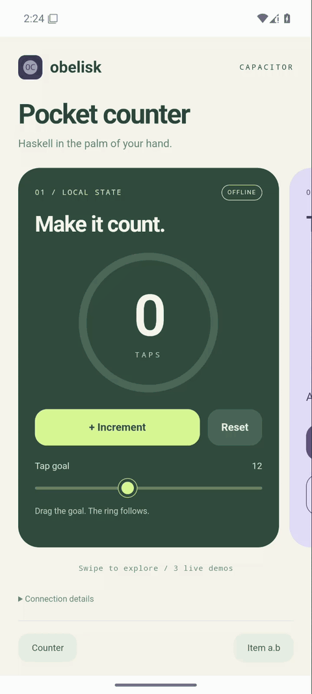

<div align="center">

# obelisk-capacitor

Package Obelisk frontends as Capacitor apps.

[](https://github.com/obsidiansystems/obelisk-capacitor/actions/workflows/mobile.yml) [](https://nixos.org) [](https://capacitorjs.com) [](https://obsidian.systems)

[Try the example](#try-the-example) | [Quick start](#quick-start) | [Native integration](./docs/native-integration.md) | [Compatibility](./compatibility.json)

</div>

obelisk-capacitor packages an
[Obelisk](https://github.com/obsidiansystems/obelisk) JavaScript frontend with
[Capacitor](https://capacitorjs.com). Reflex-DOM runs in the platform's WebView,
and JSaddle provides access to native plugins.

<p align="center">
  <picture>
    <source media="(prefers-reduced-motion: reduce)" srcset="./docs/assets/android-demo.png">
    
  </picture>
  <br>
  The counter example, running in the Android emulator.
</p>

Also verified on the iPhone 16 Simulator (iOS 26.2, Xcode 26.2).
See [iOS evidence and limitations](./docs/native-integration.md#ios).

## Try the example

From this repository root on x86_64 Linux:

```sh
NIXPKGS_ACCEPT_ANDROID_SDK_LICENSE=1 \
  nix-shell examples/counter/android.nix --run counter-android
```

This accepts the Android SDK licenses for the invocation. Nix supplies the
tools, builds the counter app and backend, and opens an Android emulator.
Your user needs read/write access to `/dev/kvm`; Android Studio is not needed.

Press Ctrl+C to stop. The [example guide](./examples/counter#run-android-with-nix)
covers headless mode, debugging and manual checks.

## Quick start

For your own Obelisk application, you need Nix, an Obelisk revision with
`webBundle`, Node 22.19+, npm 10+, Android SDK 36 and JDK 21.

From your application's root, clone the integration:

```sh
git clone https://github.com/obsidiansystems/obelisk-capacitor.git deps/obelisk-capacitor
```

Check out your chosen revision before installing dependencies. Pin Obelisk
separately; the [example's core pin](./examples/counter/deps/obelisk/thunk.nix)
is a compatible reference.

```sh
(cd deps/obelisk-capacitor && npm ci)
nix-build default.nix -A nixpkgs.webBundle.js -o result-mobile

node deps/obelisk-capacitor/bin/ob-capacitor.mjs init mobile \
  --app-id com.example.myapp --app-name "My App" --bundle result-mobile

(cd mobile && npx --no-install cap add android)
(cd mobile && npx --no-install cap run android)
```

Commit the generated `mobile/` project, excluding build output and credentials.
Your application owns its native code, plugins and signing configuration;
sync preserves them. Only JavaScript bundles are supported.

After frontend changes, rebuild and sync:

```sh
nix-build default.nix -A nixpkgs.webBundle.js -o result-mobile
node deps/obelisk-capacitor/bin/ob-capacitor.mjs sync \
  --project mobile --bundle result-mobile --platform android
```

See [native integration](./docs/native-integration.md) for plugins, backend
access, iOS, signing and migration from `obelisk-ios-xcode`.

## Development

```sh
npm ci
npm test
```

Maintained by [Obsidian Systems](https://obsidian.systems).
